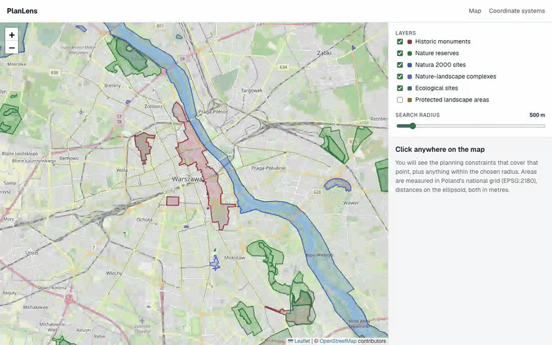
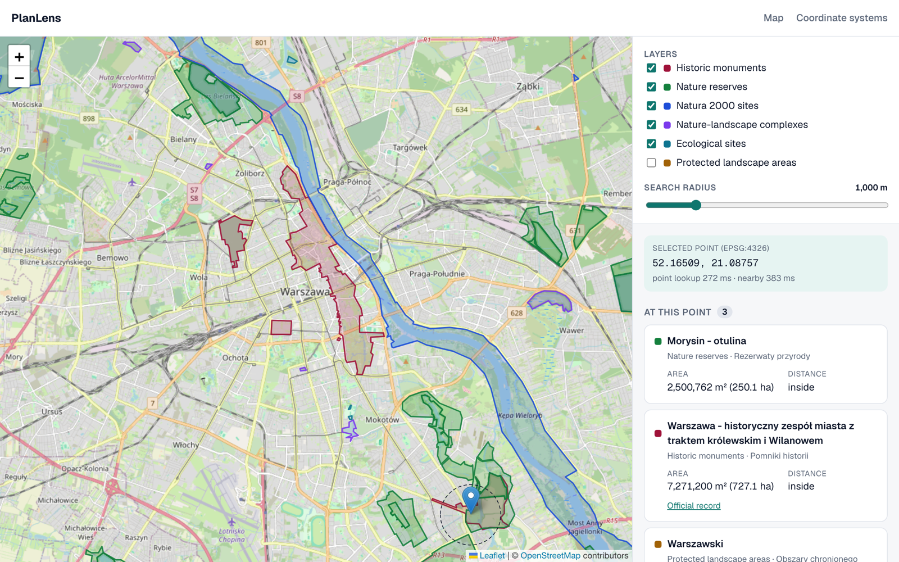

# PlanLens

Click anywhere on a map of Warsaw and see which heritage and nature-protection constraints cover that point (historic monuments, nature reserves, Natura 2000 sites and more), or sit within a chosen radius. A small portfolio demo of **GeoJSON**, **PostGIS spatial queries** and **coordinate systems** (EPSG:4326 vs 3857 vs 2180).

**Live demo: [plan-lens-eosin.vercel.app](https://plan-lens-eosin.vercel.app)** · [Coordinate systems page](https://plan-lens-eosin.vercel.app/crs)



<details>
<summary>Full-size screenshot</summary>



</details>

**Stack:** Next.js (App Router) · TypeScript · react-leaflet + OpenStreetMap tiles · Postgres + PostGIS · `pg` with hand-written SQL (no ORM, so the spatial SQL stays visible) · Vitest.

## Quick start

Needs Node 22+ and Docker.

```bash
cp .env.example .env
npm install
npm run db:up        # PostGIS in Docker (host port 5433)
npm run db:import    # applies db/schema.sql, loads data/*.geojson
npm run dev          # http://localhost:3000
```

| Script | What it does |
| --- | --- |
| `npm run db:up` / `db:down` | Start / stop the PostGIS container |
| `npm run data:fetch` | Re-download the raw data from the GDOŚ and NID WFS services into `data/` |
| `npm run db:migrate` | Apply `db/schema.sql` (idempotent) |
| `npm run db:import` | Import `data/*.geojson` (re-runnable, replaces all rows) |
| `npm run db:explain` | `EXPLAIN ANALYZE` benchmark, see [Performance](#performance) |
| `npm test` | Unit + integration tests (integration needs `db:up`) |
| `npm run test:unit` | Unit tests only, no database |
| `npm run lint` / `typecheck` / `build` | What CI runs |

> **Apple Silicon:** the official `postgis/postgis` image has no arm64 build, so `docker-compose.yml` pins `platform: linux/amd64` and it runs under emulation. Fine for this demo; timings in this README were taken that way.

## Data

Everything inside a study area of the City of Warsaw plus a margin (EPSG:2180 easting 620–658 km, northing 470–505 km). Sources, request URLs and field mappings are in `scripts/lib/sources.ts`.

| Dataset (`constraints.dataset`) | Polish designation | Publisher | Rows |
| --- | --- | --- | ---: |
| `historic-monument` | Pomniki historii | Narodowy Instytut Dziedzictwa (NID), WFS `INSPIRE_WFS_MHD` | 5 |
| `nature-reserve` (incl. buffer zones, *otulina*) | Rezerwaty przyrody | Generalna Dyrekcja Ochrony Środowiska (GDOŚ), WFS `sdi.gdos.gov.pl` | 43 |
| `natura-2000` (birds + habitats directive sites) | Obszary Natura 2000 | GDOŚ | 15 |
| `nature-landscape-complex` | Zespoły przyrodniczo-krajobrazowe | GDOŚ | 7 |
| `ecological-site` | Użytki ekologiczne | GDOŚ | 8 |
| `protected-landscape-area` | Obszary chronionego krajobrazu | GDOŚ | 2 |

Some features reach well outside the city (Kampinos Forest, the Vistula and Bug valleys, the Warsaw Protected Landscape Area); they are kept whole.

**Licence.** GDOŚ's WFS capabilities declare no fees and no access constraints; NID's declare no licence terms. Both are Polish public-sector data. Attribute "GDOŚ" and "Narodowy Instytut Dziedzictwa", and check their terms before reusing the data beyond a demo. Boundaries are informational; the legal record is the designation act.

**The source data is EPSG:2180 (PUWG 1992, metres), not lon/lat.** The raw files are kept exactly as the services return them (each still carries a `crs` member, which RFC 7946 GeoJSON no longer allows). The import reprojects them once to EPSG:4326; see below.

## Architecture

```
GDOŚ / NID WFS  ──(data:fetch)──▶  data/*.geojson  (EPSG:2180, as published)
                                       │ db:import: ST_SetSRID(…, 2180) → ST_Transform(…, 4326)
                                       ▼
Postgres + PostGIS   constraints (geom MultiPolygon 4326, area_m2 generated in 2180)
                     constraint_parts (ST_Subdivide pieces, maintained by trigger)
                                       ▲  parameterised SQL (pg)
Next.js Route Handlers ── validate & clamp params
                                       ▲  GeoJSON [lng,lat] / named lat,lng params
Browser (Leaflet, EPSG:3857 on screen)
```

### Project layout (feature-first)

```
src/
  app/                       thin routes: pages and /api handlers only
  features/
    map/          components/ hooks/ types/ utils/         Leaflet map, viewport loading, controls
    constraints/  components/ hooks/ server/ types/ utils/ results panel, SQL queries, validation
    crs/          components/ server/ types/               /crs page and its ST_Transform query
  shared/         lib/ hooks/ components/ types/ testing/  db pool, http wrapper, param parsing
scripts/          fetch-data.ts, import.ts, migrate.ts, explain.ts, lib/sources.ts
db/               init.sql (Docker init), schema.sql (PostGIS extension, tables, indexes)
data/             raw GeoJSON (EPSG:2180)
```

Tests sit next to the code they cover (`*.test.ts`); tests that need the database are `*.integration.test.ts`.

### API

All params are validated; every query is parameterised (`$1…$n`, never string-built).

| Endpoint | Returns | Validation |
| --- | --- | --- |
| `GET /api/constraints?lat=&lng=` | constraints containing the point | lat −90..90, lng −180..180, otherwise `400` |
| `GET /api/nearby?lat=&lng=&radius=` | constraints within `radius` metres with distance and area | radius clamped to 1..5000 m (default 500) |
| `GET /api/features?bbox=minLng,minLat,maxLng,maxLat[&zoom=&limit=&datasets=]` | GeoJSON `FeatureCollection` for the viewport, clipped and simplified | bbox clamped to the world, inverted box `400`; limit ≤ 1000 |
| `GET /api/area?id=` | area of one feature in m² (EPSG:2180) | positive integer, `404` if unknown |
| `GET /api/crs?latA=&lngA=&latB=&lngB=` | two points in 4326/3857/2180 and four distance measurements | as lat/lng |

Latitude and longitude are **rejected**, not clamped, when out of range: quietly moving a bad point to the nearest valid one would return confident wrong answers. Radius, limit, zoom and bbox are clamped.

## The spatial SQL

**Import** (`scripts/import.ts`), all in SQL:

```sql
ST_Transform(ST_SetSRID(ST_GeomFromGeoJSON($geojson), 2180), 4326)   -- per source feature, into staging
…
SELECT ST_Multi(ST_CollectionExtract(ST_Union(ST_MakeValid(geom)), 3))   -- one row per source key
FROM import_staging GROUP BY dataset, source_key;
```

`ST_Union … GROUP BY` is there because NID splits one monument into several Polygon records, and a Natura 2000 site designated under both directives appears once in each layer. A reserve and its buffer zone share an INSPIRE code but are separate designations, so the key also includes the name. `ST_CollectionExtract(…, 3)` keeps polygons only, since `ST_MakeValid` can emit lines. For the bundled data, 83 source features become 80 rows and 1 invalid geometry is repaired.

**Schema** (`db/schema.sql`): two things that keep requests fast with large polygons.

```sql
area_m2 double precision GENERATED ALWAYS AS (ST_Area(ST_Transform(geom, 2180))) STORED

-- trigger on constraints: pieces of at most 256 vertices
INSERT INTO constraint_parts (constraint_id, geom) SELECT NEW.id, ST_Subdivide(NEW.geom, 256);
CREATE INDEX … ON constraint_parts USING GIST (geom);
CREATE INDEX … ON constraint_parts USING GIST ((geom::geography));
```

**Point lookup**, against the parts (a point inside any part is inside the constraint):

```sql
SELECT DISTINCT p.constraint_id FROM constraint_parts p
WHERE ST_Intersects(p.geom, ST_SetSRID(ST_MakePoint($lng, $lat), 4326));
```

**Nearby**, in metres via `geography`; a constraint's distance is the minimum over its parts:

```sql
SELECT p.constraint_id, min(ST_Distance(p.geom::geography, pt.g)) AS distance_m
FROM constraint_parts p, pt
WHERE ST_DWithin(p.geom::geography, pt.g, $radius)
GROUP BY p.constraint_id;
```

**Viewport**: bounding-box overlap served by the GIST index, clipped to the viewport plus 25 % per side, then simplified at low zoom:

```sql
SELECT ST_AsGeoJSON(ST_SimplifyPreserveTopology(ST_ClipByBox2D(c.geom, v.clip), $tol), 6)
FROM constraints c
WHERE c.geom && ST_MakeEnvelope($minLng, $minLat, $maxLng, $maxLat, 4326)
LIMIT 1001;      -- one extra row tells the client the result was truncated
```

The simplification tolerance is one screen pixel in degrees (`360 / (256 · 2^zoom)`), applied below zoom 15. The map only requests features from zoom 9 up, for the current viewport only, so the whole dataset is never sent.

## Coordinate systems

You can read this section on its own, or try it live on the **/crs** page.

| CRS | Units | Role here |
| --- | --- | --- |
| **EPSG:2180** PUWG 1992 | metres | What GDOŚ and NID publish. Where **areas** are measured: `ST_Area(ST_Transform(geom, 2180))`. |
| **EPSG:4326** WGS84 lon/lat | degrees | Storage format, after reprojecting on import. What GeoJSON and Leaflet's API speak. |
| **EPSG:3857** Web Mercator | metres, but stretched | What Leaflet and OSM tiles draw. Never used for measuring. |

**Why not measure in degrees?** `ST_Area` and `ST_Distance` on 4326 geometry return square degrees and degrees. In Warsaw a degree of longitude is about 68 km but a degree of latitude is about 111 km. Measured from the Royal Castle (52.2479, 21.0142), which is E 637 462, N 488 784 in EPSG:2180:

| Method | 0.01° east | 0.01° north |
| --- | ---: | ---: |
| `ST_Distance` on 4326 geometry | 0.01 | 0.01 |
| `ST_Distance` on `::geography` | 683.0 m | 1,112.7 m |
| `ST_Distance` after `ST_Transform(…, 2180)` | 682.7 m | 1,112.2 m |
| `ST_Distance` after `ST_Transform(…, 3857)` | 1,113.2 m | 1,818.4 m |

So: **distances** use `::geography` (correct anywhere, ellipsoidal metres) and **areas** use 2180, a metric projection built for Poland whose scale error in Warsaw, about 140 km from its central meridian (19°E), is roughly −0.05 %. Web Mercator, stretched by 1/cos(52.25°) ≈ 1.64, is for drawing. The integration tests check the 2180 area against an independent `geography` area and require agreement within 0.2 %.

**The lon/lat vs lat/lon pitfall.**

| Where | Royal Castle | Order |
| --- | --- | --- |
| GeoJSON | `[21.0142, 52.2479]` | `[lng, lat]` |
| PostGIS | `ST_MakePoint(21.0142, 52.2479)` | `(x, y)` = `(lng, lat)` |
| Leaflet | `L.latLng(52.2479, 21.0142)` | `[lat, lng]` |

Swapped, that point lands in the Arabian Peninsula's Empty Quarter, and both numbers are still valid coordinates, so range checks cannot catch it. The code avoids positional pairs: points are `{ lat, lng }` objects everywhere, the API takes named `lat=`/`lng=` params, and the only conversions to arrays are in `features/map/utils/coords.ts` (with tests). A PostGIS integration test also asserts that a swapped point finds nothing.

**The same trap in a projected CRS.** The EPSG definition of 2180 lists **northing first**. PostGIS's `ST_X`/`ST_Y` and GeoJSON output use easting, northing, but services that follow the EPSG axis order do not:

| Request / format | Order for EPSG:2180 |
| --- | --- |
| GDOŚ GeoServer, WFS 1.0.0 `BBOX` | easting, northing |
| NID, WFS 2.0.0 `BBOX` | **northing, easting** |
| NID, GML output (`posList`) | **northing, easting**: Przemyśl comes back as `226500 772054` |
| NID, GeoJSON output | easting, northing |

`scripts/lib/sources.ts` writes the same study area in both orders, and the project only consumes GeoJSON.

## Performance

Warm local server (`curl`, Docker PostGIS under emulation):

| Request | Time | Payload |
| --- | ---: | ---: |
| `/api/constraints` (point inside the 118k-vertex Warsaw Protected Landscape Area) | ≈ 20 ms | |
| `/api/nearby`, radius 500 m / 5 km | ≈ 25 / 35 ms | |
| `/api/features`, zoom 12, whole city, default layers | ≈ 45 ms | 65 kB |
| `/api/features`, zoom 16, all layers | ≈ 30 ms | 5 kB |

All comfortably inside the 300 ms target. The results panel also shows the measured round trip for each click. Two fixes got it there, both caused by single features with huge vertex counts:

- **`ST_Subdivide` + a generated area column.** Before, `/api/nearby` took **230–370 ms**: each call ran `ST_DWithin`, `ST_Distance` and `ST_Transform` over the full Warsaw Protected Landscape Area polygon (118,475 vertices). Querying 256-vertex parts and storing `area_m2` brought it to **20–35 ms**.
- **Clipping in `/api/features`.** That polygon alone is **2.5 MB** of GeoJSON at full detail and would be sent with every pan at zoom 15+. Clipped to a zoom-16 riverside view it is **1.8 kB**.

`npm run db:explain` runs the viewport and nearby SQL against a **synthetic table of 200,000 random polygons across Poland** (the real table is too small for the planner to bother with indexes) and reports the median of 7 `EXPLAIN (ANALYZE)` runs:

| Query | Index | Median execution time | Plan |
| --- | --- | ---: | --- |
| viewport (`&&`, 83 rows) | none | 186.85 ms | Seq Scan |
| viewport (`&&`, 83 rows) | `GIST (geom)` | **2.18 ms** | Bitmap Index Scan |
| nearby (`ST_DWithin` geography, 2 rows) | none | 3318.56 ms | Seq Scan |
| nearby | `GIST (geom)` only | 3417.00 ms | Seq Scan, **the index is ignored** |
| nearby | `GIST ((geom::geography))` | **0.19 ms** | Index Scan |

(Emulated amd64 on Apple Silicon; absolute numbers will differ, the ratios are the point. The benchmark table has no subdivision, since its polygons are small.)

## Testing

- **Unit** (no database): param validation and clamping, zoom → simplification tolerance, coordinate-order helpers, formatters, static-image URLs, and the source registry. That covers reading the `crs` member in each shape the WFS servers emit, and the reserve-vs-buffer-zone / Natura merge keys.
- **Integration** (Dockerised PostGIS): each file creates a throwaway schema, loads rectangles around known points in Warsaw, and checks:
  - a point inside a polygon, inside two overlapping polygons, and outside;
  - distances in metres, and areas in m² against an independent measurement;
  - viewport filtering, clipping of a huge feature, truncation and simplification;
  - that subdivision covers each constraint exactly, that the generated area matches a live `ST_Transform`, and that the GIST indexes exist.

  They never touch the imported data.
- **CI** (`.github/workflows/ci.yml`): lint, type-check, all tests against a PostGIS service container, and a production build.

## Deploy

1. Create a Neon (or Supabase) Postgres database.
2. Locally, with `DATABASE_URL` pointing at it as the database owner (Postgres 15+ only lets the owner create tables in `public`) and `sslmode=verify-full`, run `npm run db:import`. It enables PostGIS, creates the schema and loads the data.
3. Deploy the repo to Vercel and set `DATABASE_URL` in the project's environment variables (use the pooled connection string).

## What I learned

- Not all source data is lon/lat. Polish public data arrives in EPSG:2180; declare it with `ST_SetSRID` and reproject with `ST_Transform` once, on the way in.
- Axis order is a trap in projected systems too. The same EPSG:2180 bounding box has to be written easting-first for one WFS and northing-first for another.
- One huge polygon can dominate everything. `ST_Subdivide` for point and distance tests, `ST_ClipByBox2D` for drawing, and a generated column for area that would otherwise be re-projected on every request.
- A `::geography` cast in a `WHERE` clause silently disables a plain GIST index. Index the cast expression.
- `geography` is the easy way to get metres; a national projected CRS is the right way to get areas; Web Mercator is for pixels.
- `ST_MakeValid` can return lines or points, so `ST_CollectionExtract(…, 3)` before `ST_Multi`. And `ST_Subdivide` drops collinear vertices, so a densified rectangle is a poor test fixture for it.
- Leaflet needs `window`, so the map is loaded with `dynamic(..., { ssr: false })` from a client component, and `react-leaflet`'s `<GeoJSON>` reads `data` only once, so a changed response needs a new `key`. Turbopack compiles an image imported from `node_modules` to a URL string, not Next's `{ src }` object.

## Out of scope / future work

Auth, user accounts and vector tiles. For larger datasets the next step is serving tiles with `ST_AsMVT` / `ST_TileEnvelope` instead of GeoJSON per viewport. More Warsaw layers would fit the same `sources.ts` pattern, e.g. local zoning plans (MPZP) or the full heritage register.
